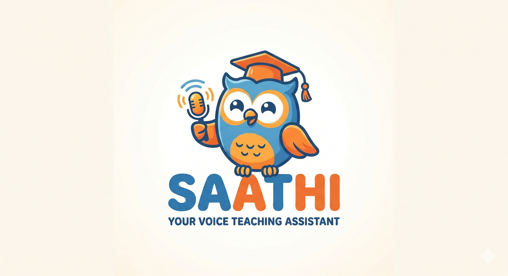

<div align="center">



# saAthI (साथी) — Voice Teaching Assistant

**A multilingual, voice-enabled AI tutor that explains any topic in English, Hindi or Hinglish, with spoken narration, an illustration and a quick quiz.**


[](https://gemini.google.com/)


</div>

---

## Table of Contents

- [Overview](#overview)
- [Features](#features)
- [How It Works](#how-it-works)
- [Tech Stack](#tech-stack)
- [Project Structure](#project-structure)
- [Getting Started](#getting-started)
- [Usage](#usage)
- [Configuration](#configuration)
- [Testing](#testing)
- [Known Limitations](#known-limitations)
- [Troubleshooting](#troubleshooting)
- [Future Work](#future-work)

---

## Overview

*saAthI* ("साथी" means *companion*) is a voice-first teaching assistant. A learner either **speaks** or **types** a topic, and the app responds with:

1. a short (~75–100 word) explanation generated by Google Gemini,
2. a relevant educational image,
3. an MP3 narration of the explanation, and
4. an optional multiple-choice quiz question on the same topic.

The whole experience, covering the AI output, speech recognition, speech synthesis and the UI itself, is available in three languages and two teaching personas.

## Features

### Languages

| Language | AI output | Speech input | Speech output | UI |
|---|---|---|---|---|
| **English** | English | `en-IN` | gTTS `en` (Indian accent, `co.in`) | English |
| **Hindi (हिंदी)** | Devanagari script | `hi-IN` | gTTS `hi` | Fully Hindi |
| **Hinglish** | Hindi in Roman script, mixed with English terms | `hi-IN` | gTTS `en` (Indian accent, `co.in`) | Hinglish |

The language can be switched at any time from the sidebar or the buttons on the main page.

### Teaching personas

- **Teacher Mode**: structured, encouraging, concept-focused, with real-world applications.
- **Student Mode**: a friendly "study buddy" that uses everyday analogies and fun comparisons.

### Voice

- **Voice input**: click **🎤 Speak Topic** and ask your question out loud.
- **Emoji-free narration**: the on-screen answer keeps its emojis and formatting, but the text sent to text-to-speech is cleaned first. Emojis, flags, keycaps, variation selectors and Markdown syntax (headers, bold, links, code, bullets) are stripped, so the voice never reads out "rocket emoji".
- **Audio player**: play/pause, seek bar, volume, playback speed and MP3 download, using the browser's native audio controls. Optional autoplay for the newest answer and a **Replay Voice** button.
- **Desktop speaker playback**: optionally also plays the audio on the host machine's speakers.

### Learning aids

- **Quick Topics**: one-click starters (Photosynthesis, Water Cycle, Solar System, Gravity, Human Heart, AI & Robotics).
- **Illustrations**: fetched from Wikipedia/Wikimedia Commons, with an AI-generated illustration as a fallback.
- **Knowledge-check quiz**: a one-question multiple-choice quiz, with the correct answer and explanation hidden behind a reveal button.
- **Responsive layout**: works on phones, tablets and desktops.

## How It Works

```
 ┌──────────────┐   speech.py    ┌──────────────┐    llm.py     ┌────────────────────┐
 │ Mic / Typed  │ ─────────────► │   Topic /    │ ────────────► │ Gemini 2.5 Flash   │
 │    input     │  Google STT    │   Question   │               │ (language + persona│
 └──────────────┘                └──────────────┘               │  system prompt)    │
                                                                 └─────────┬──────────┘
                                                                           │ explanation
                          ┌────────────────────────────────────────────────┼───────────────┐
                          ▼                                                ▼               ▼
                 llm.get_image()                                   tts.clean_text_   llm.generate_quiz()
          Wikipedia thumbnail → Pollinations                        for_tts() → gTTS   (on button click)
                          │                                                │               │
                          └──────────────► app.py (Streamlit UI) ◄────────┴───────────────┘
                                   image + text + audio player + quiz
```

1. `app.py` collects input from the mic (`speech.listen`), a quick-topic button, or the chat box.
2. `llm.explain_topic` builds a language-specific system instruction plus a persona prompt and calls Gemini.
3. `llm.get_image` looks for a Wikipedia thumbnail for the topic and falls back to a generated illustration.
4. `tts.get_tts_audio_bytes` cleans the answer and synthesises MP3 bytes in memory with gTTS.
5. Streamlit renders the image, text and audio player. Clicking **Quiz** calls `llm.generate_quiz`.

Chat history lives in Streamlit session state, so it is per browser session and is lost on refresh.

## Tech Stack

| Concern | Library / Service |
|---|---|
| Web UI | [Streamlit](https://streamlit.io) |
| LLM | Google Gemini (`gemini-2.5-flash`) via `google-generativeai` |
| Speech-to-text | [`SpeechRecognition`](https://pypi.org/project/SpeechRecognition/) + Google Web Speech API, mic access via `PyAudio` |
| Text-to-speech | [`gTTS`](https://pypi.org/project/gTTS/) (Google Translate TTS) |
| Emoji / Unicode cleaning | [`regex`](https://pypi.org/project/regex/) (supports `\p{Extended_Pictographic}` etc.) |
| Local playback | `playsound` |
| Images | Wikipedia REST API, with Pollinations AI as fallback |
| Config | `python-dotenv` |

## Project Structure

```
saathi/
├── app.py              # Streamlit app: UI, localisation strings, session state, orchestration
├── llm.py              # Gemini prompts for explanations and quizzes, image lookup
├── speech.py           # Microphone capture + speech-to-text
├── tts.py              # Emoji/Markdown stripping + gTTS synthesis + local playback
├── test.py             # Manual smoke test for llm.explain_topic
├── test_speech.py      # Manual test for microphone input
├── test_tts.py         # Assertions for emoji stripping + audio generation
├── requirements.txt    # Pinned dependencies
├── assets/
│   └── logo.png        # Sidebar logo
├── .streamlit/
│   ├── config.toml     # Disables usage stats
│   └── credentials.toml
└── .env                # Your API key (not committed; see Configuration)
```

## Getting Started

### Prerequisites

- **Python 3.13** (the version the project was developed on; earlier 3.x versions will probably work, but are untested)
- A **Google Gemini API key**: get one free at [Google AI Studio](https://aistudio.google.com/app/apikey)
- A working **microphone** (only for voice input)
- An **internet connection**. Gemini, Google speech recognition, gTTS and the image APIs are all online services.

### 1. Clone and create a virtual environment

```bash
git clone https://github.com/Supriya-dahiya/saathi.git
cd saathi

python -m venv .venv
source .venv/bin/activate        # Windows: .venv\Scripts\activate
```

### 2. Install system audio libraries (for the microphone)

`PyAudio` needs PortAudio:

| OS | Command |
|---|---|
| Windows | Nothing extra, since `pip install PyAudio` ships wheels |
| macOS | `brew install portaudio` |
| Debian / Ubuntu | `sudo apt install portaudio19-dev python3-dev` |

### 3. Install Python dependencies

```bash
pip install -r requirements.txt
```

> **Note:** `requirements.txt` is saved in UTF-16 (the default of PowerShell's `pip freeze > requirements.txt`). Modern pip reads it fine, but some tools and editors don't. It also lists many packages the app does not import (`torch`, `openai-whisper`, `pandas`, `mysql-connector-python`, …), which makes the install slow and large. If you only want to run the app, this is enough:
>
> ```bash
> pip install streamlit google-generativeai python-dotenv requests \
>             SpeechRecognition PyAudio gTTS regex playsound==1.2.2
> ```

### 4. Add your API key

Create a `.env` file in the project root:

```env
GOOGLE_API_KEY=your_gemini_api_key_here
```

`.env` is already listed in `.gitignore`. **Never commit it or share it in a zip.**

### 5. Run

```bash
streamlit run app.py
```

The app opens at <http://localhost:8501>.

## Usage

1. **Pick a language and persona** in the sidebar (or use the language buttons on the main page).
2. **Ask a question**. Click a *Quick Topic*, click **🎤 Speak Topic** and talk, or type in the chat box.
3. **Read, look and listen**. The explanation appears with an illustration and an audio player. Autoplay and desktop-speaker playback can be toggled in the sidebar.
4. **Test yourself**. Click **Test Yourself with a Quiz**, then **Reveal Correct Answer & Explanation**.
5. **Replay or clear**. Use **Replay Voice** to hear the last answer again, or **Clear Chat History** to start over.

## Configuration

| Setting | Where | Notes |
|---|---|---|
| `GOOGLE_API_KEY` | `.env` | Required. Loaded in `llm.py`, searching the working directory first and then the script's folder. |
| Gemini model | `llm.py` (`gemini-2.5-flash`) | Change the string in `explain_topic` and `generate_quiz`. |
| Answer length | `llm.py` (`explain_topic` prompt) | Currently "around 75 to 100 words". |
| Mic timeout / phrase limit | `speech.py` | 6 s wait, 12 s max phrase, 0.8 s ambient-noise calibration. |
| Streamlit options | `.streamlit/config.toml` | Usage stats disabled; `headless = false` auto-opens the browser. |

## Testing

The tests are simple scripts, not a pytest suite. They need internet access, and `test_speech.py` needs a microphone.

```bash
python test_tts.py       # emoji stripping assertions + English/Hindi/Hinglish audio generation
python test.py           # prints a Gemini explanation of "Photosynthesis" (needs API key)
python test_speech.py    # speak after the prompt; prints the recognised text
```

## Known Limitations

- **Voice input and desktop-speaker playback only work when the app runs on your own machine.** `SpeechRecognition` opens the microphone of the computer running Streamlit, not the browser's. If the app is deployed to a server (Streamlit Cloud, etc.), the mic button won't capture the visitor's voice. Browser-side audio capture would be needed.
- **Everything needs internet.** There is no offline mode for the LLM, STT or TTS.
- **Image relevance varies.** The Wikipedia lookup uses the title-cased query as a page title, so short topics such as "Gravity" match well while full questions such as "How does photosynthesis work?" usually fall through to the AI-generated image fallback.
- **Quick-topic queries are always sent in English**, even when the UI is Hindi; only the button labels are localised.
- **Hinglish speech** is recognised with the `hi-IN` model, so heavily English sentences may be transcribed imperfectly.
- **Free-tier API limits.** Heavy use may hit Gemini rate limits, in which case the app displays the error message in place of the answer.
- **Pinned `google-generativeai` is a legacy SDK.** Google's newer `google-genai` package is the long-term replacement.

## Troubleshooting

| Problem | Fix |
|---|---|
| "I encountered an error generating the explanation" | Check `GOOGLE_API_KEY` in `.env`, that the key is valid, and that you're online or within quota. |
| `PyAudio` fails to install | Install PortAudio first (see [step 2](#2-install-system-audio-libraries-for-the-microphone)). |
| Mic button says it could not detect speech | Check the OS microphone permission and default input device, and speak within ~6 seconds of the prompt. |
| No sound on desktop speakers | `playsound` can be flaky on some systems. Use the in-browser audio player, or untick **Play on desktop speakers**. |
| Audio player missing | gTTS needs internet. Check the console for a `[TTS Error]` line. |
| Hindi text/speech looks wrong | Make sure the language is set to **Hindi** and your terminal/browser supports Devanagari. |

## Future Work

- Browser-based microphone capture so voice input works when deployed
- Multi-question quizzes with scoring and progress tracking
- Conversation memory for follow-up questions
- Additional Indian languages
- Offline/local STT (e.g. Whisper) and TTS
- A proper `pytest` suite with mocked network calls

---

